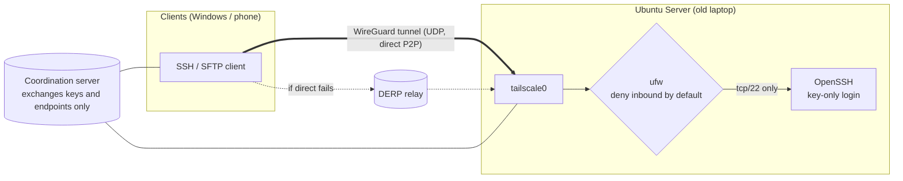

# secure-homeserver

[](https://github.com/<GITHUB_USER>/secure-homeserver/actions/workflows/shellcheck.yml)

Turn a spare laptop into a Linux server that **exposes no ports to the public internet** yet can be managed securely from anywhere.

Built on Tailscale (WireGuard) as a zero-trust private network, with access control enforced at three layers: network, firewall and SSH. Every change is made by idempotent scripts and can be rolled back with a single command.

## Features

- **Zero public exposure**: no public IP or port forwarding required; ufw denies all inbound traffic by default and SSH is reachable only on the `tailscale0` interface
- **Three layers of access control**: Tailscale ACLs decide who can reach the server → ufw decides which interface and port may come in → sshd decides who may log in and how
- **SSH hardening**: key-only authentication, no root login, an explicit user allowlist, plus built-in lockout protection
- **ACL as code**: the access policy lives in Git and is tested and deployed by GitHub Actions (GitOps)
- **Laptop-as-server mode**: disables sleep and hibernation, ignores the lid switch and turns off Wi-Fi power saving so the machine never drops offline when idle
- **Health checks**: reports the connection path (direct P2P or DERP relay), latency, security settings and system resources; can run on a systemd timer
- **Reversible**: every change lives in its own drop-in file, and `rollback.sh` undoes everything in one step

## Architecture



See [docs/architecture.md](docs/architecture.md) for details.

## Requirements

- Ubuntu Server 22.04 / 24.04 (the versions this project is designed for)
- A Tailscale account
- Client: any device running Tailscale (Windows, macOS, Linux, iOS, Android)

## Quick start

On the server:

```bash
git clone https://github.com/<GITHUB_USER>/secure-homeserver.git
cd secure-homeserver
chmod +x scripts/*.sh

# 1. Install Tailscale and join the tailnet (Tailscale SSH off; OpenSSH handles SSH)
sudo ./scripts/setup-tailscale.sh --hostname homeserver
```

On the client (Windows PowerShell shown), generate a key pair and upload the public key:

```powershell
ssh-keygen -t ed25519
type $env:USERPROFILE\.ssh\id_ed25519.pub | ssh <USER>@<TAILSCALE_IP> "mkdir -p ~/.ssh && chmod 700 ~/.ssh && cat >> ~/.ssh/authorized_keys && chmod 600 ~/.ssh/authorized_keys"
```

Back on the server:

```bash
# 2. Harden SSH (refuses to run if no public key is found, so you can't lock yourself out)
sudo ./scripts/harden-ssh.sh

# 3. Firewall: SSH allowed on tailscale0 only
sudo ./scripts/firewall.sh

# 4. Laptop-as-server: no sleep, ignore lid close
sudo ./scripts/server-mode.sh

# 5. Health check (--peer is the name of another device in your tailnet)
sudo ./scripts/healthcheck.sh --peer <CLIENT_DEVICE>

# 6. Optional: run the health check every hour
sudo ./scripts/install-timer.sh --peer <CLIENT_DEVICE>
```

Every script supports `--help` and is safe to run repeatedly.

### Rollback

```bash
sudo ./scripts/rollback.sh                 # undo everything
sudo ./scripts/rollback.sh ssh firewall    # undo selected components
```

## Sample health check output

```text
== Tailscale ==
[ OK ] tailscaled is running
[ OK ] Connected to tailnet
[ OK ] Tailscale SSH is off; port 22 is handled by OpenSSH
[ OK ] Direct P2P path to <CLIENT_DEVICE> (in 44ms)

== SSH ==
[ OK ] OpenSSH is running
[ OK ] Password authentication disabled
[ OK ] Root login disabled
...
Health check finished: 0 failures, 0 warnings
```

## Layout

```text
.
├── scripts/
│   ├── lib.sh               # shared helpers
│   ├── setup-tailscale.sh   # install Tailscale and join the tailnet
│   ├── harden-ssh.sh        # SSH hardening
│   ├── firewall.sh          # ufw rules
│   ├── server-mode.sh       # no sleep, ignore lid, Wi-Fi power saving off
│   ├── healthcheck.sh       # health check
│   ├── install-timer.sh     # scheduled health check (systemd timer)
│   └── rollback.sh          # one-step rollback
├── tailscale/policy.hujson  # Tailscale ACL (managed via GitOps)
├── docs/                    # design notes and troubleshooting log
└── .github/workflows/       # ShellCheck and ACL deployment
```

## Documentation

| Document | Contents |
|---|---|
| [architecture.md](docs/architecture.md) | Network layout, NAT traversal and DERP relays, three-layer access control |
| [ssh-decision.md](docs/ssh-decision.md) | Tailscale SSH vs. OpenSSH: comparison and decision |
| [acl-gitops.md](docs/acl-gitops.md) | Managing Tailscale ACLs with GitHub Actions |
| [file-transfer.md](docs/file-transfer.md) | When to use SFTP, scp or Taildrop |
| [troubleshooting.md](docs/troubleshooting.md) | Real problems encountered, how they were diagnosed, and their root causes |

## Design principles

- **Never edit stock config files**: only add separate files under directories such as `sshd_config.d/` and `logind.conf.d/`, so changes are easy to review and revert
- **Lockout protection**: check for a public key before disabling passwords; check where the current SSH session comes from before enabling the firewall; make sure SSH stays reachable after removing firewall rules
- **Validate before applying**: new sshd config is checked with `sshd -t` and reverted automatically if invalid

## License

[MIT](LICENSE)
