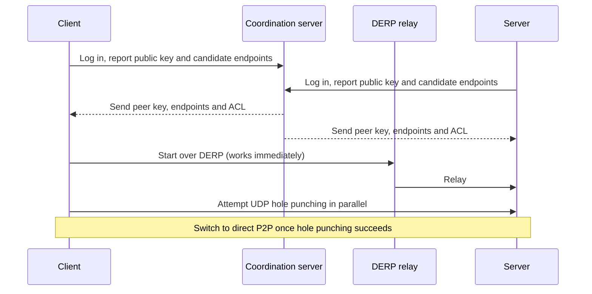

# Architecture

## Goals

- Reach the server from anywhere, even when it sits behind NAT with no public IP
- Expose no ports to the public internet, keeping the attack surface as small as possible
- Keep the configuration reproducible, reviewable and reversible

## Components

| Layer | Component | Role |
|---|---|---|
| Network | Tailscale (WireGuard) | Assigns each device a `100.x.y.z` address; devices talk over encrypted tunnels |
| Network policy | Tailscale ACL | Decides, tailnet-wide, which devices may reach which ports on the server |
| Host firewall | ufw | Denies all inbound traffic by default; allows only tcp/22 on `tailscale0` |
| Login | OpenSSH | Allows only listed users and key-based authentication |
| Operations | healthcheck + systemd timer | Periodically checks connectivity and security settings |

## How a connection is established



1. The **coordination server** only exchanges public keys, candidate endpoints and ACLs. It **never carries user traffic**.
2. The peers first communicate through a **DERP relay**. DERP runs over HTTPS (port 443), so it works on almost any network.
3. Meanwhile both sides attempt **NAT traversal** (UDP hole punching). On success they switch to a **direct P2P** path with lower latency and higher bandwidth.
4. Traffic is always end-to-end encrypted by WireGuard; DERP relays cannot see the contents.

### Checking which path is in use

```bash
tailscale status              # the peer's line shows direct or relay "xxx"
tailscale ping <device>       # "via <IP>:<port>" = direct; "via DERP(xxx)" = relayed
tailscale netcheck            # local UDP availability, NAT type and latency to each DERP region
```

Measured result: with the client on mobile data and the server on a different network, `tailscale ping` showed a **direct IPv6 P2P** path at about **44 ms**. When both ends have public IPv6 addresses, no NAT traversal is needed and direct connections succeed very reliably.

### Common reasons direct connections fail

- Both ends are behind symmetric NAT (e.g. carrier-grade NAT)
- The network blocks UDP or only allows specific outbound ports
- A firewall strictly limits outbound traffic

In these cases the connection **automatically stays on the DERP relay**. Everything still works, just with higher latency and lower bandwidth. `firewall.sh --open-tailscale-udp` opens 41641/udp, which improves the chance of a direct path when the server has a public address.

## Three layers of access control (defense in depth)

```text
┌───────────────────────────────────────────────────────────────────┐
│ 1. Tailscale ACL: only tailnet members may reach tag:server tcp/22 │
│  ┌─────────────────────────────────────────────────────────────┐  │
│  │ 2. ufw: deny inbound by default; allow only tcp/22 on        │  │
│  │    tailscale0                                                │  │
│  │  ┌───────────────────────────────────────────────────────┐  │  │
│  │  │ 3. sshd: AllowUsers, keys only, no root, MaxAuthTries  │  │  │
│  │  └───────────────────────────────────────────────────────┘  │  │
│  └─────────────────────────────────────────────────────────────┘  │
└───────────────────────────────────────────────────────────────────┘
```

If any one layer is misconfigured, the other two still hold:

- The ACL is accidentally set to allow everything → ufw still only allows port 22
- A service temporarily listens on `0.0.0.0` → both the ACL and ufw block it
- A user has a weak password → sshd doesn't accept passwords at all

## Why not port forwarding or a public IP

| Approach | Problem |
|---|---|
| Router port forwarding + public IP | Many networks (campus networks, carrier-grade NAT) don't provide a public IPv4 address; port 22 on the internet is constantly scanned and brute-forced |
| Reverse proxy on a cloud VM (frp, etc.) | Requires an extra server; the proxy can see plaintext traffic unless you add another layer of encryption |
| Traditional VPN (OpenVPN, self-hosted WireGuard) | Requires a VPN server with a public address; keys and routes are maintained by hand |
| **Tailscale** | No public address needed; automatic NAT traversal; end-to-end encryption; ACLs managed as code |

The trade-off is a dependency on Tailscale's coordination server. For full self-hosting, it can be replaced with the open-source Headscale; the clients and this project's scripts need little or no change.
